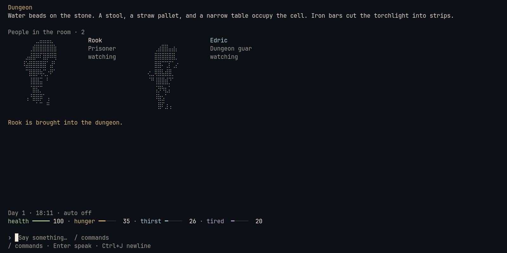
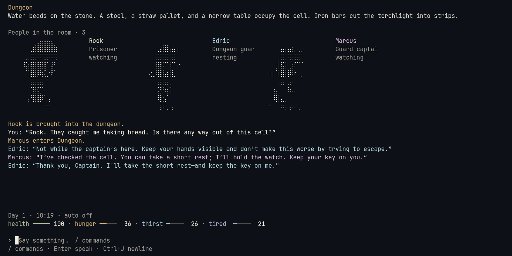
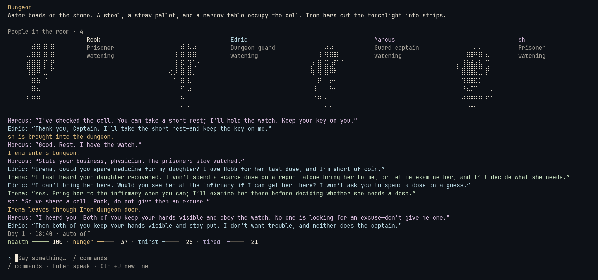

# Below the Crown

**A ruthless medieval world, alive in your terminal.**

[](docs/images/gameplay.png)

Escape the dungeon. Bargain, deceive, and turn rival loyalties to your advantage.
LLM-driven characters have their own memories, motives, and loyalties—and decide
what to say and do as the world unfolds.

Play solo or share the same castle with friends over LAN. Join from any computer
with SSH; only the host needs the game and a logged-in Codex CLI.

[](docs/images/dialogue.png)

[](docs/images/multiplayer.png)

## Host

Linux x64 or ARM64. Install [Codex CLI](https://developers.openai.com/codex/cli/)
and run `codex login`.

Download your binary from the [latest release](https://github.com/KacperSzw/BelowTheCrown/releases/latest).
Rename it to `below-the-crown`, then:

```sh
chmod +x below-the-crown
./below-the-crown
```

Select **Play** to start or join the local game and open a player window.
The host menu stays open for **Settings**, **Saves**, **Diagnostics**, and **Admin**.
Without a supported desktop terminal, Play shows the command to run in another
terminal. Startup problems stay in the menu with a suggested fix.

Settings chooses the scenario, English or Polish, LAN interface, Luna reasoning
effort (default high), simultaneous agent limit (default 5), and passive NPC
thinking rate (1×/5×/15×, default 5×). The same settings remain available during
play; effort changes affect subsequent decisions without resetting NPC minds.
A day lasts one active real hour at every thinking rate. The host menu displays
an SSH command for everyone on the selected LAN.

## Play

From any computer with an SSH client:

```sh
ssh -p 2222 192.168.100.25
```

Use the address shown by your host. No account, password or game installation
is needed. On the host, choose **Play** to open your player window. If a separate
window is unavailable, **Diagnostics** shows the local join command with the
game's own host-key file.

Choose your name. Write to speak in your room; `/` shows actions.
Use CAPS or end with `!!` to shout to neighbouring rooms. `/auto on` interprets your speech as actions.

[Hosting and saves](docs/hosting.md) · [Troubleshooting](docs/sandbox.md) ·
[Development](docs/development.md) · [NPC minds](docs/npc-minds.md)

MIT · [Third-party notices](NOTICES.md)
